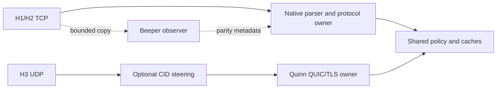

# Design and experimental method

These notes accompany the [research summary](README.md) and
[measurements](measurements.md). They describe experiments and the contracts
required before enabling kernel serving.

## One cache and policy authority

HTTPJet decides admission, routing, authentication, rewrites, representation
selection and cache eligibility. A kernel cache must mirror finalized,
revocable representations from that authority. A path-only response table
cannot represent the same behavior.

Identity includes listener/configuration generation, scheme, trust context,
vhost/original authority, full path/query, encoding and relevant Vary inputs.
Initial serving eligibility is public invariant GET responses with bounded
complete bodies. Other requests retain the native path until equivalent
contracts are established.

Publication needs a token captured before authoritative selection. Minting a
new token after purge could teach an old response into a new epoch. Publication
and purge acknowledgement must share a revocation boundary. Expiry, reload,
lost invalidation and controller failure withdraw eligibility. Date, Age and
request identifiers remain per-response values. Representation equality alone
does not authorize bypassing quotas, limits, logging or completion accounting.

## H1 and H2

The observer uses Beeper 0.1.3 and xbpf 0.0.3 on explicitly enrolled accepted
sockets, with socket identity and process-bound control. Original bytes pass
immediately. There is no global cgroup hook, request redirection, input corking
or trusted private command embedded in a client stream.

Its helper corpus covers split input, exact bytes, readable prefixes before the
remainder arrives, pipelining/body preservation, invalid enrollment and cleanup.
The limited native HTTPJet corpus passed eight cases in each of off/observe
mode, with byte/header parity. Aggregate observer counters recorded seven
matches, two coverage declines and no mismatches/errors; those counters include
setup traffic and are not a one-to-one count of test cases. This is not all-flow
parser coverage. Observation is plaintext-only and covers a bounded first H1
head or first complete H2 HEADERS block. CONTINUATION, dynamic-index coverage
and unsafe queued/racing enrollment are outside this observation scope; native
serving continues. The observation lease is five seconds. Captures never
authorize a cached response or kernel output.

The tested freplace/DynPtr integration needed an observer-specific fixed-span
adapter for verifier bounds. Generic caller length bounds were insufficient at
that call site. This describes the tested kernel/objects/integration, rather
than a general Beeper defect.

H1 serving also needs ordered permanent demotion on a miss, original input
preservation and shared connection activity/request counts. H2 must retain one
owner for HPACK, SETTINGS, streams, credit, resets and writes. Independent
engines cannot advance state and then blindly replay into another owner.

The rejected SK_MSG experiment kept native protocol ownership and expanded
selected bodies through socket-local one-time commits. Its optimized version
reused body bindings and advanced a nonce in kernel, eliminating per-hit map
syscalls. Server-thread CPU still increased. This rejects that body-only tier;
it does not measure complete request/policy/cache bypass.

## H3

H3 reuses HTTPJet's generation-pinned on-core cache path before bridging
unsupported work. Ready work can finish its initial poll on the connection
owner; pending work continues from the same pinned future. Declines leave the
inline driver before bridge dispatch. Attempts are bounded for fairness.

The original H3 static fixture used the shared static-body cache through the
full pipeline. It did not enter the finished-response memo already available
to native H1/H2. Making that on-core path available to H3 is a material part of
the observed gain; it is not an in-kernel HTTP/3 parsing result.

Payload Bytes transfer through framing and Quinn's owned send queue, retaining
reservations until transport references disappear. Small partial responses are
compacted to avoid pinning large backing allocations. This removes particular
whole-body copies; encryption and packet construction remain.

Runnable connections survive the cooperative pump limit, preserving queued
stream-credit events. Graceful drain tracks response FIN acknowledgement: an
empty application queue can still leave data queued inside QUIC. STOP and
connection loss reclaim state/leases; an uncooperative peer remains bounded by
the existing drain deadline.

Quinn owns QUIC/TLS, packet protection, loss, congestion and streams. io_uring
UDP retains GSO/GRO and the existing network stack. Optional CID-aware reuseport
routing selects a registered worker; it neither decrypts nor serves HTTP.
AF_XDP zero-copy, migration and full kernel QUIC/H3 are unqualified here.

## Method and limits

Runtime runs only on SINGULARITY: Intel i9-9900K, x86-64, WSL2 Linux
7.3.0-microsoft-standard-WSL2. The H3 server uses CPUs 8,10 and the client uses
0,2,12,14, on separate physical cores in the recorded topology. Egress
microprobes instead pin their server/client threads to CPUs 4,6.

Comparisons use release/native-PGO builds, recorded identities, matching inputs
and balanced run order. Existing caches remain enabled. H3 clients use distinct
UDP ports, verified fixture TLS, persistent connections and fixed counts. Every
timed status/body is validated. The egress microprobe verifies full headers/body
and kernel counters. The early captured-response wrapper is not used as proof
of semantic parity.

Correctness probes cover HEAD, Range, conditionals, missing routes, purge/refill,
headers and fresh Date. Bad body/status, TLS identity and setup controls check
that invalid runs are rejected. Revised clients mark unsuccessful runs invalid
and report null throughput.

Record warmup, socket buffers/drops, worker activity and resource scopes with
rates. Process CPU omits some kernel/IRQ work. Linux VM counters include other
activity and cannot observe Windows-host scheduling. Memory high-water sums are
not simultaneous peaks. WSL loopback cannot establish NIC zero-copy gains or
production-wide CPU savings.

These fixed-concurrency saturation tests exclude waiting before admission.
Matched offered-load latency, repeated final-source cache matrices, mixed
misses, privacy/invalidation races and complete lifecycle qualification remain
necessary. Cross-checkpoint rates with different source, profiles or binaries
are not isolated code-change estimates.

## References

- [Laurin Brandner / @lerboe](https://github.com/lerboe)
- [Beeper](https://github.com/lerboe/beeper)
- [hyper-fast-path](https://github.com/lerboe/hyper-fast-path)
- [Linux sockmap](https://docs.kernel.org/bpf/map_sockmap.html)
- [Linux kTLS](https://docs.kernel.org/networking/tls.html)

Remaining research includes a stable bounded parser-extension interface, safe
H2 ownership/handoff, authenticated kTLS integration and kernel contracts that
remove enough request work to beat an already cached native server.
